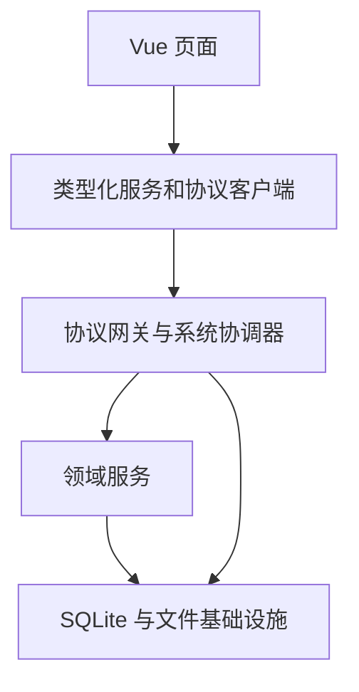

# GankSoft v0.6.0 RC 实现说明

## 交付状态

已实现新的前后端协议、界面接入、新数据空间、内容/备份容器和维护恢复流程。交付源码及 Windows x64 可执行 ZIP。正式发布仍受 Win10/Win11 实机验收门禁约束；本次不声称完成双系统验收。

## 复用和范围

主干基于 v0.5.1 的 Application、SQLite 业务表、题目/记忆卡服务、知识树、导入映射、FSRS、评估、图表及 Vue 组件修改。逐文件哈希见 `reuse-ledger.json`。保留有效业务断言，旧数据库迁移、旧备份兼容及旧协议测试按新需求删除或重写；删除清单见 `validation/removed-compatibility-cases.json`。

PickQ 参考固定在 `31753c5f106f76b5ae556c8511521777bf23898a`：采用内容和媒体分离、内容包身份与版本区分、元数据预检及领域划分的设计思路。本次没有复制其源码或打包其 Java/Tauri/H2 运行时。没有把 PickQ 的简化记忆间隔替换现有 FSRS。

直接复用成熟库：Vue、Electron、Zod、ts-fsrs、@napi-rs/image、yauzl、yazl、Cytoscape、MindElixir。ZIP 解压、图像解码、记忆模型不从零实现。

## 模块与调用

| 边界 | 实现 | 约束 |
|---|---|---|
| 界面到后台 | 唯一 `gank:protocol` IPC | 无任意 command/SQL/路径执行接口 |
| 公共契约 | 注册表定义 56 个方法 | 输入严格，未知字段和未知方法拒绝 |
| 实体和内容版本 | 新实体 UUID；公共内容版本 UUIDv8 | 私有领域保留单调序号，公开版本身份绑定卡片；revision 独立用于并发控制 |
| 数据传输 | camelCase 普通 JSON | 有限数、深度/节点/字节限制，双向验证 |
| 领域存储 | SQLite schema 600 与应用标识 | 拒绝旧版和未知库，不迁移旧数据 |
| 文件系统/模型服务 | 后台系统协调器 | 窗口来源校验、主进程文件对话框、AI 明确确认 |

内容 UUID 根据卡片 UUID 和私有内容序号确定生成；客户端投影层将其还原为复用视图需要的私有序号，提交时重新携带 UUID。后台验证卡片绑定再进入领域规则。对象 revision 表示编辑并发版本，不作为内容身份。

私有 Application 调用名称和部分视图字段继续复用 v0.5.1 实现；它们不通过预加载暴露，不是旧客户端兼容接口。现有历史/会话冻结载荷仍包含序列化 JSON；后续增加独立远程服务时，应进一步拆为专用只读 DTO，避免把内部载荷扩展为跨网络合同。

## 功能落点

| 功能 | 主要代码 | 当前行为 |
|---|---|---|
| 文件夹/卡片集 | modules/folders、decks | UUID、层级循环检查、类型与归属校验、删除恢复 |
| 错题/记忆卡 | modules/questions、memory、cards | 录入、修改、笔记、材料、图片、批量操作和内容版本隔离 |
| 知识库 | modules/knowledge | 树、关系、合并、图谱保存、不可变存档和引用 |
| 会话 | modules/sessions | 草稿、揭示、提交、下一张、跳过、重开及结束的校验 |
| 作答与调度 | modules/review、assessment | 独立证据评估、FSRS、回执、观察记录、统计与时间线 |
| 导入导出 | modules/imports、export | 二进制附件 ZIP、预览映射、版本/重复导入校验 |
| 图片 | infrastructure/images、main | 成熟解码器验证；批量先预检后事务提交，失败清理文件 |
| 回收站 | modules/trash | 影响预览、恢复、永久删除和附件清理状态 |
| 备份恢复 | infrastructure/backup、restore-journal | SQLite 在线快照、校验清单、暂存验证、目录替换和中断回滚 |
| 可选 AI | modules/ai、main | 受限文字证据、确认后调用、系统凭据加密和过期结果标记 |

## 知识点选择交互更新

错题和记忆卡复用 `KnowledgePicker.vue`，以思维导图替代平铺复选框。展开当前卡片集的知识树后，可多选已有节点，在选中父节点下新增，或切换为新增一级节点。显示完整路径、支持逐个移除、搜索定位、键盘操作和焦点约束。

确认选择后回填卡片；取消保留原有关联。新增知识点立即保存，界面明确提示取消选择不会删除新增节点。切换卡片集清空旧关联，知识树按目标卡片集读取，避免串集。复用现有 MindElixir 和统一知识点 API，不增加新的绘图库或公开协议。

卡片列表的知识点筛选也复用该组件，以 `purpose="filter"` 启用只读筛选模式。通过 `workspace.read` 读取当前卡片集知识树，返回选中的知识点 ID；确认后仅更新筛选条件，保留包含下级、任意/全部匹配等规则。筛选入口不提供新增知识点，不修改卡片关联，只有保存筛选方案时才调用 `filters.save`。

## 评估与调度规则

保留 ts-fsrs 5.4.2 的 FSRS 模型及行测独立作答评估。猜测、记住答案、提前查看解析作为观察证据保存；不能借此增加独立方法成功证据。同日未再次到期的巩固不反复延长排期；有效的独立失败可进入重学。练习模式不修改计划。

移除平滑“掌握分”的生成和 UI 排名，不用单分数代表考试能力。保留每次自评、客观对错、方法理解、独立证据天数、用时、FSRS 稳定性/难度/可提取性和到期时间。历史数据库列继续为领域服务占位，新的平滑分写入为空。

最大间隔范围 1—3650 天，新卡片集默认 365 天；每日默认 15 项。修改卡片/卡片集策略或移动卡片不会立即改写当前计划，从下一次有效复盘应用。目标保持率当前固定 0.9，没有加入未经验证的个性化训练。

学习时区首次创建时固定保存；后台日历判定与证据汇总使用该时区。界面“今天”的统计使用相同学习时区，系统显示时区改变不会改变每日调度边界。

## 状态、事务和恢复

调用状态：created → validating → ready → executing → outputValidated → committing → succeeded；重复写请求可直接 replayed；异常进入 rollingBack/rejected 或 unknown。请求 ID、方法及规范化参数摘要共同决定重放是否允许。

学习状态：answer → reveal → result → answer/finished。后台检查会话 revision、entryId、队列、内容版本和揭示前原始答案/思路。作答记录、冻结快照、FSRS、业务回执和会话进度共同提交；协议回执失败时外层事务回滚。

系统文件操作不跨 await 持有 SQLite 写事务。持久操作日志先记录 pending，完成后写回执；进程在副作用后中断时禁止自动重做。设置中的“待核对操作”允许用户核对实际文件/数据后填写说明解除锁定，保留审计记录。

恢复先校验临时数据库、外键、业务 JSON、历史图片和清单，再替换目录。替换前同步写恢复日志；启动时发现未确认交换会回到原目录，保留未确认目录。恢复成功更新 dataEpoch，使旧请求失效。

## 容器与资源边界

内容容器：manifest.json、content.json、assets/*；内部业务格式 `ganksoft.content/2.0`。完整备份：manifest.json、database.sqlite、attachments/*；格式 `ganksoft.backup/1`，仅接受 schema 600。

ZIP 读取限制：源文件及累计展开最大 512 MiB，单条目最大 128 MiB，最多 10000 项；拒绝路径逃逸、反斜杠/绝对路径、大小写重复、加密条目、符号链接、实际展开超限、哈希或附件引用不一致。不直接按压缩包路径解压到用户目录。

公共请求预算为 2 MB，并限制结构深度与节点数。图片通过后台 fileToken 保留，不把 base64 图片往返 IPC。工作区查询支持 section、deckId、offset、limit，SQL 使用 LIMIT/OFFSET；页面仍将所需分页结果聚合到内存，超大历史集的专用聚合统计与虚拟滚动仍有改进空间。

## 扩展约定与限制

新增功能提交模块归属、输入/输出 Schema、effect、handler、能力登记、归属/版本检查、状态转换和失败测试。查询不能产生业务写入；写入必须定义事务所有者、幂等键和结果未知时的恢复行为。新增领域模块可通过注册表及服务门面接入，无需扩大预加载权限。

当前是进程内模块化后台，不是独立远程 HTTP 服务；前后端以共享契约分离。没有开放运行任意第三方代码的插件系统。未来联网服务须补充认证、授权、远程限流和传输保护，不能直接把桌面 IPC 暴露为网络端点。

未实现 PickQ 文件互导、OCR/PDF/Word 自动解析和自动更新服务。未进行负载容量承诺、独立渗透测试或正式合规认证。依赖审计零告警仅代表本次 npm 生产依赖数据库检查，不代表无漏洞。
