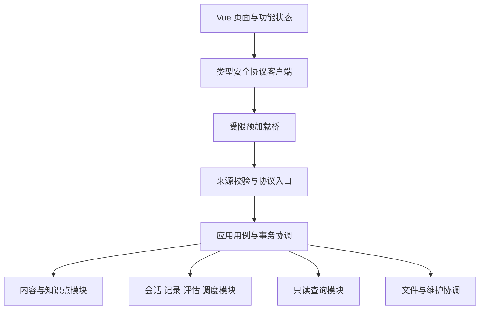
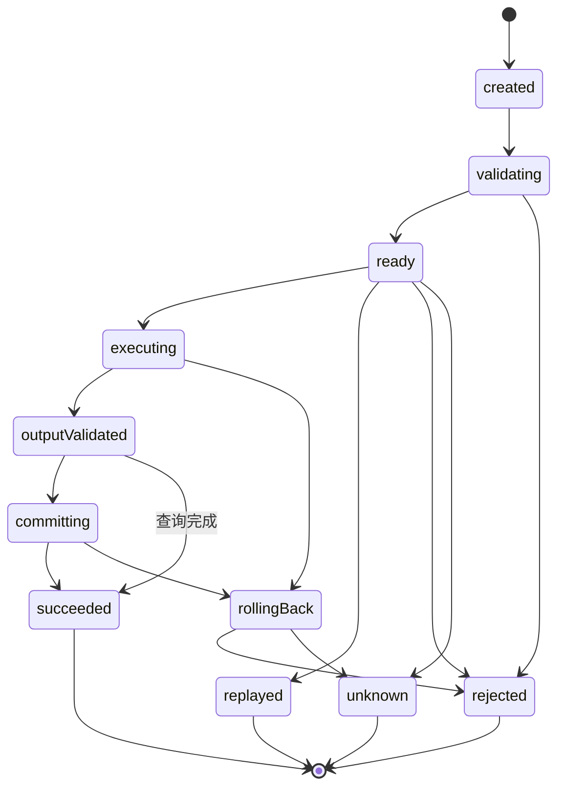
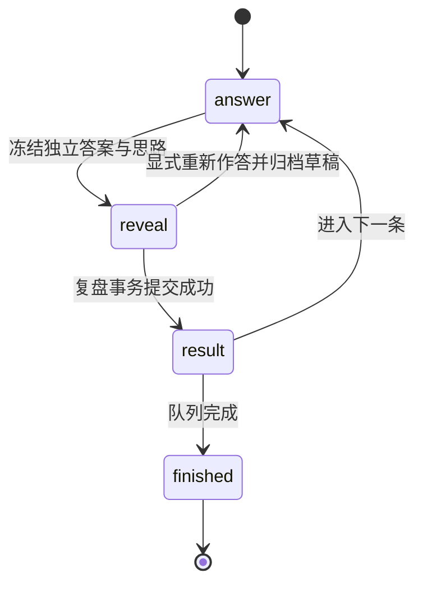

# GankSoft v0.6.0 模块架构 API 数据协议与调用状态机

> 文档版本 1.0 · 内部协议 1.0 · 2026-10-17

本规范承接 v0.6.0 设计报告 1.1，统一模块职责、前后端边界、API、数据类型、调用状态机和扩展规则。代码基线为 v0.5.1，已有业务与算法优先复用，不从零重写。

## 1 交付范围和实现状态

本次已实现独立的协议定义、类型安全客户端、后端调用入口、运行时校验、事务与回执存储、调用状态机和学习状态转换；向现有 Electron 预加载层增加受限的 `gank:protocol` 入口。

**当前定义 25 个方法，19 个已绑定现有后台业务，6 个保留接口尚未绑定。** 能力查询分别返回 definedMethods 与 supportedMethods。未绑定的方法返回 METHOD_UNAVAILABLE，不返回虚构成功。

旧界面仍使用原 `src/api.ts`，新界面接入使用 `src/protocol.ts`。本次为协议基础代码交付，不是宣称旧页面全部完成迁移或 v0.6.0 正式版已经发布。源码应用版本仍保留 0.5.1，避免把基础代码包当成正式 0.6.0 EXE。

本规范的业务分层是目标边界；兼容适配器中仍有既有 Application 调用与少量数据库查询。它们须后续下沉到所属模块的查询仓储，不能把适配器继续扩大成新的业务中心。

## 2 前后端分离架构

桌面应用的前后端分离指逻辑和权限分离，不要求为本地程序额外启动 HTTP 服务。首选受限 IPC，未来可以增加 HTTP 传输适配而保持业务 DTO 与用例不变；HTTP 接入时须另行设计鉴权、来源约束和速率限制。



前端允许依赖 Vue、视图模型和共享协议。前端不导入 Electron 主进程、SQLite、Node 文件系统或密钥实现；不能接收通用 SQL 和任意路径能力。共享协议仅依赖纯代码与 Schema 库，不依赖后端或 UI。

后端负责身份与来源、卡片集范围、版本冲突、正确性判定、有效性门控、FSRS、事务、回执及文件生命周期。前端预览仅用于展示，后台结果为最终依据。

## 3 功能模块清单和边界

| 模块 | 负责的数据和功能 | 公开能力 | 禁止职责 |
| --- | --- | --- | --- |
| catalog | 文件夹、卡片集、类别与归属 | 查询、创建、修改、移动预检 | 直接修改作答和 FSRS |
| content | 错题、记忆卡、内容版本、材料与资产引用 | 内容发布、摘要、版本查询、软删除 | 原位覆盖历史事实 |
| knowledge | 知识树、关联、方法和版本存档 | 节点维护、关联、合并、存档 | 根据一次答错推断能力 |
| sessions | 队列、阶段、草稿、当前条目和修订号 | 保存、揭示校验、推进、退出 | 自行计算下一次排期 |
| records | 每次作答、回忆、用时、思路和反思 | 追加记录、分页查历史和详情 | 重新计算旧记录的评分 |
| assessment | 独立证据、理解、自评和效率规则 | 纯输入到评估结果 | 读取数据库或系统时钟 |
| scheduler | FSRS、到期时间、调度事件和策略 | 计算新状态、保存事件、读取预测 | 直接解释表单或答案 |
| analytics | 正确率、方法成功、效率和图表 | 只读聚合及序列 | 触发学习或调度写入 |
| exchange | 外部格式识别、校验、导入计划 | 预览、冲突、提交协调 | 绕过内容服务直接入库 |
| media | 图片校验、存储、引用和清理任务 | 受限 token 导入、按 ID 读取 | 任意文件读取或执行 |
| maintenance | 完整备份、恢复、回收与诊断 | 暂存校验、维护锁、阶段恢复 | 将文件操作视为 SQL 回滚的一部分 |
| ai | 明确同意的文本辅助 | 请求、取消、只读结果 | 自动改题、写调度或保存明文密钥 |
| application | 跨模块业务用例 | 协调端口与原子提交 | 成为所有模块表的公共仓储 |

模块之间通过公开服务、查询端口和稳定 DTO 协作。后端内部同步调用不必重复序列化 JSON 或走 IPC；跨进程和不可信输入必须执行完整协议校验。禁止模块调用相邻模块的私有函数和仓储。应用用例可以协调多个模块，但不允许业务模块反向依赖应用用例。

## 4 主要调用关系

| 用例 | 调用顺序 | 事务所有者 |
| --- | --- | --- |
| 发布错题版本 | 内容校验 → 内容保存 → 调度重置端口 → 提交后失效通知 | 内容发布用例 |
| 错题复盘 | 校验会话与版本 → 冻结策略 → 评估 → 有效性门控 → FSRS → 记录与进度 | 复盘提交用例 |
| 记忆复盘 | 校验会话 → 四档回忆评价 → 有效性门控 → FSRS → 记录与进度 | 公共复盘提交用例 |
| 修改卡片策略 | 校验对象与设置 → 保存覆盖或取消覆盖 → 返回生效来源 | 策略用例 |
| 查看历史图表 | 卡片范围 → 分页记录或统计查询 → DTO → 视图模型 | 无业务写事务 |
| 导入内容 | 受限文件 token → 容器检查 → 格式适配 → ImportPlan → 预览 → 内容服务 | 导入提交用例 |
| 完整恢复 | 维护锁 → 暂存验证 → 关闭连接 → 目录切换 → 数据代次更新 | 恢复协调器 |
| AI 辅助 | 同意范围 → 证据只读查询 → 服务调用 → 展示待采纳结果 | 网络调用不持有数据库事务 |

复盘记录、评估、调度事件、当前调度状态、会话推进、协议回执在同一数据库事务提交。内部模块嵌套调用使用 SAVEPOINT，不能提前提交外层事务。通知和缓存失效只能在提交成功后发出。

当前兼容适配器沿用 v0.5.1 的策略行为：缩短最大间隔可能提前已有排期，dailyLimit 为 1—200，maxIntervalDays 为 1—365。设计报告中更宽参数及“仅影响未来”的策略属于后续独立行为升级，不能误认为本次已经实现。接口 Schema 与当前实现限额一致。

## 5 数据协议

所有公开字段使用 camelCase，传输值为普通 JSON；不发送 Date、Map、BigInt、Vue Proxy、undefined、非有限数、循环对象和库内部对象。空值使用 null；0 是实际零值，不等于未测量。输入拒绝未知业务字段。

| 公共类型 | 约定 |
| --- | --- |
| Id | 不透明字符串，1—150 字符；现有内置集标识仍有效；不得作为文件路径 |
| requestId | UUID；每个逻辑写操作一次生成，失败未知时不能换 ID |
| dataEpoch | 数据代次 UUID；恢复后重新生成，旧请求不再有效 |
| revision | 非负整数，用于对象并发检查，与内容版本分开 |
| contentVersion | 非负整数，保留基线已有版本语义；与卡片 ID 组合定位内容 |
| Timestamp | UTC ISO 8601，例如 2026-10-17T01:00:00.000Z |
| CardKind | question 或 memory；使用判别联合，不能混用作答字段 |
| Rating | again、hard、good、easy；由后端适配到 FSRS 枚举 |
| 时长 | 0—86400 秒或 null；保留真实 0 与缺失区别 |
| 自评分 | 0—10，0.1 步进；正确性相关区间继续由业务评估校验 |
| 选项 | 四项结构化 key/text，A—D 不重复；适配层转换既有文本格式 |

内容数据、复盘事实、评估和调度状态分别定义，不通过“整张数据库行”传输。当前协议 CardRef 使用 cardId、kind、contentVersion；此前报告中的 contentVersionId 只是目标示意，本规范以可运行 Schema 为准。若未来改为独立版本 UUID，必须升级契约并提供适配。

单次调用采取 2MB 估算预算、24 层结构深度、10 万节点预算；此限制由调用边界执行，不能依赖 JSON.stringify 后才发现问题。导入和备份采用文件 token，禁止把大型文件和任意路径塞进调用信封。文件预算与普通调用预算独立。

## 6 请求和结果信封

请求示例：

```json
{
  "protocol": { "major": 1, "minor": 0 },
  "requestId": "9cfa8466-e1bd-4593-84b8-97227b171098",
  "dataEpoch": "eeae191e-2161-4510-9cb1-7716c3f35375",
  "method": "content.list",
  "payload": { "deckId": "question-default", "offset": 0, "limit": 50 }
}
```

成功信封固定为 ok、requestId、dataEpoch、dataRevision、data。失败信封固定为 ok、requestId、dataEpoch、error；error 包含 code、message、outcome、retryable 和 fieldErrors 数组。非法请求无法取得合法编号时 requestId 为 null。

outcome 为 rejected 或 unknown。成功仅在事务提交完成后返回；提交结果未知不能当作失败再新建操作。客户端校验响应编号、代次、信封和方法输出，不接受另一请求的结果。

初次先调用 app.capabilities，dataEpoch 可为 null；其他调用必须使用能力查询返回的代次。当前仅接受精确的协议 1.0，不承诺任意未来 minor 自动兼容。新增字段必须在相应版本 Schema 中明确接收。

当前分页为后端 limit/offset，并返回 dataRevision；尚未实现绑定范围的游标和快照分页。它避免全量读取，但并发变动时前端须刷新，不能声称已具有稳定快照遍历能力。后续游标应绑定范围、筛选、版本和代次。

## 7 API 清单

| 方法 | 类型 | 当前接入 |
| --- | --- | --- |
| app.capabilities | 查询 | 已接入 |
| catalog.decks | 查询 | 已接入 |
| catalog.saveDeck | 命令 | 已接入 |
| catalog.saveFolder | 命令 | 已接入 |
| content.list | 查询 | 已接入，数据库分页 |
| content.saveQuestion | 命令 | 已接入，结构化选项适配 |
| content.saveMemory | 命令 | 已接入 |
| content.delete | 命令 | 已接入，校验对象修订 |
| knowledge.list | 查询 | 已接入 |
| knowledge.save | 命令 | 已接入 |
| knowledge.publishArchive | 命令 | 已接入 |
| session.save | 命令 | 已接入，草稿和修订校验 |
| session.delete | 命令 | 已接入，身份和修订校验 |
| review.submit | 命令 | 已接入，区分错题和记忆 |
| review.receipt | 查询 | 已接入，持久回执 |
| records.list | 查询 | 已接入，数据库分页 |
| policy.setCard | 命令 | 已接入，保留基线策略语义 |
| policy.setDeck | 命令 | 已接入，保留基线策略语义 |
| assessment.setTarget | 命令 | 已接入，继承和显式不设目标分开 |
| exchange.preview | 查询 | 已定义，待接 token 和导入计划协调 |
| exchange.commit | 命令 | 已定义，待接预览绑定与提交 |
| media.import | 命令 | 已定义，待接文件 token |
| maintenance.backup | 维护 | 已定义，待接异步维护协调 |
| maintenance.restore | 维护 | 已定义，待接异步维护协调 |
| ai.analyze | 查询 | 已定义，待接同意 token 与异步网络执行 |

所有方法的字段与输出以 `shared/protocol/registry.ts` 为唯一来源；`docs/protocol/contracts-v1.json` 是自动导出。JSON Schema 描述结构，Zod refinements 和后端范围校验补充业务语义；不能只校验 JSON Schema 就跳过后者。

前端调用示例：

```ts
await initializeProtocol();
const page = await protocolClient.call('content.list', {
  deckId: 'question-default', limit: 50
});
```

需要可靠重试时先 prepare，再保存请求并 send；请求未知时保留同一对象和编号。不能在重试按钮里重新 call 创建新编号。

## 8 调用状态机

调用状态机已经由 `shared/protocol/lifecycle.ts` 定义，后端 host 实际推进状态。状态观察只用于诊断；观察回调失败不得影响业务。



| 路径 | 状态序列与约束 |
| --- | --- |
| 查询成功 | created → validating → ready → executing → outputValidated → succeeded；不增加写修订和回执 |
| 写入成功 | created → validating → ready → executing → outputValidated → committing → succeeded |
| 已提交重放 | ready → replayed；返回原回执，不再运行 handler，不再修改数据 |
| 输入拒绝 | validating → rejected；不能运行业务函数 |
| 输出不合约 | executing → rollingBack → rejected；不能让已产生的领域写入留存 |
| 提交状态未知 | 提交或回滚路径进入 unknown；查询原回执后决定重试 |

业务写入、输出校验、修订增加与回执保存同属外层事务。输出错误也必须回滚。新协议请求编号跨方法共用，复用相同编号但改方法或负载返回 IDEMPOTENCY_CONFLICT。

unknown 是调用结果分类，不等于数据库一定未提交。测试覆盖“已保存回执但返回丢失”，重新执行原请求会重放回执，不重复写入。回执 notFound 也不能作为传输中请求绝不会提交的证明；通过单写入通道和相同编号重试收敛。

## 9 学习会话状态机



已揭示阶段不能悄悄回写独立作答；重新作答必须换 entryId 并保留原稿。未成功提交不能推进下一条。失效卡片跳过由后端验证，并保留放弃的草稿；不把跳过计为成功复盘。

会话内 review.submit 必须携带 sessionId 和 expectedSessionRevision；服务端验证冻结条目、内容版本、答案和思路。练习标记采用持久会话中的值，不允许客户端从 practice=true 改为 false 取得有效调度证据。

学习阶段的 reveal → result 已接入后端 recordSaved，非法阶段提交由状态机拒绝。finished 是队列结束的规范状态，当前旧页面仍通过会话删除结束；下一阶段迁移需统一结束 DTO，不把纯状态函数的测试当成旧页面全部迁移完成。

## 10 错误和恢复

| 错误码 | 处理 |
| --- | --- |
| VALIDATION_ERROR / INVALID_DATA / RESOURCE_LIMIT | 定位字段或限制，修正输入；不自动换编号重复提交 |
| CONTRACT_UNSUPPORTED | 重新确认匹配的软件与接口版本 |
| METHOD_UNSUPPORTED | 方法未定义，不允许回落任意命令执行 |
| METHOD_UNAVAILABLE | 方法有定义但当前后台未接入 |
| REVISION_CONFLICT / CONTENT_VERSION_CONFLICT | 保留草稿，重新读取并由用户确认 |
| DECK_CONFLICT | 对象归属改变或跨集，拒绝提交 |
| IDEMPOTENCY_CONFLICT | 相同编号对应不同操作，不覆盖原回执 |
| DATA_EPOCH_CHANGED | 旧请求失效，重新握手并重建会话 |
| OUTPUT_INVALID / RESPONSE_INVALID | 后端输出错误应回滚；客户端无法确认时按 unknown 处理 |
| TRANSPORT_UNKNOWN / COMMIT_UNKNOWN | 使用原请求和回执收敛，不新建一次业务效果 |
| INTERNAL_ERROR | 返回脱敏信息，内部诊断定位 |

备份恢复的现有流程已在切换成功后更新协议代次；协议表本身保存独立 schema_version=1，发现不支持版本拒绝继续写入。完整的后续迁移框架仍按 v0.6.0 主报告实施，不能将 CREATE IF NOT EXISTS 当成升级方案。

## 11 可扩展规则

新增功能必须同时提交：模块归属、输入输出 Schema、方法 effect、类型化 handler、能力登记、权限与范围校验、状态转换、错误语义和测试。只有绑定并通过验证的 handler 才出现在 supportedMethods。

新题型使用判别联合增加内容结构、编辑器、判题器和导入映射，不把未知类型转成单选；新调度器通过端口替换，不修改记录格式；新外部格式先规范化为 ImportPlan，不增加第二条业务入库路径。

当前 host 为同步数据库用例执行器，拒绝 Promise 处理器。文件和网络的异步执行须由独立协调器分阶段完成，数据库事务只包短期写入。新增异步任务应定义 taskId、状态、取消和查询，或增加保持同一信封的异步执行器；禁止通过移除 Promise 检查把网络调用塞进 SQL 事务。

内部契约版本、数据库结构、内容包结构、评估规则和 FSRS 状态分别升级。历史评估按原版本解释，不因新代码发布而重评。打包必须包含新协议的运行时依赖 Zod，许可证随源码和程序分发；自定义 Windows 打包脚本已加入该依赖。

## 12 源码位置

| 文件 | 用途 |
| --- | --- |
| shared/protocol/data.ts | 公共 DTO、资源边界和协议错误 |
| shared/protocol/registry.ts | API 注册表、输入输出类型和 Schema |
| shared/protocol/host.ts | 服务端信封校验、路由、事务和回执协调 |
| shared/protocol/client.ts | 前端客户端、响应校验和未知结果保留 |
| shared/protocol/lifecycle.ts | 调用与学习状态机 |
| electron/protocol/sqlite-store.ts | 持久代次、修订和回执 |
| electron/protocol/gateway.ts | v0.5.1 业务适配，camelCase 到既有字段转换 |
| electron/main.ts 与 preload.cts | 受限 IPC 及调用来源验证 |
| src/protocol.ts | 新前端调用入口 |
| tools/protocol | Schema 导出、类型负向检查和边界检查 |
| tests/protocol-v1.test.ts | 协议、状态机、真实业务、回滚与恢复测试 |

现代设计检查落实为具体规则和测试，不把选用框架或新增目录当成符合标准的证明。协议层边界检查不代表已经检查完全部旧模块依赖。下一阶段按纵向切片迁移页面和旧入口，最后关闭通用旧命令通道。

## 13 验证和使用

执行环境为 Linux、Node 24。验证记录见代码包中的 `validation-results/protocol`。本次不包含 Windows EXE，也未进行 Win11 实机验证；本包用于后续开发，不能代替正式版本的源码和 EXE 双包交付。

安装后执行：

```sh
npm ci
npm run check:protocol
npm test
npm run build
```

原有界面和业务仍可按基线开发方式启动；通过新入口调用前先初始化能力查询。`npm run check:protocol` 会验证协议、类型约束和依赖边界，再自动生成机器可读契约。实际测试结果以随包日志和摘要为准，不沿用历史成绩作为本轮通过证据。

## 14 后续迁移完成标准

1. 所有页面使用类型安全服务；删除动态字符串和 any 型公开 API。
2. 旧 gank:call 和系统能力通道收敛到已验证的方法，不保留绕过新校验的写入路径。
3. 六个保留方法具备 token、异步协调和成品验证后再开放能力。
4. 适配器的直接查询下沉到领域只读接口；覆盖全仓库的依赖检查。
5. 把分页修订、历史详情、配置版本和完整迁移框架补齐到正式版标准。
6. 对 Windows 成品执行 IPC、备份恢复、重启、原生依赖与离线验证，再交付正式双 ZIP。

上述项目是正式 v0.6.0 完成门槛；本次已交付的协议基础、真实适配和测试可直接作为实施基线复用。
